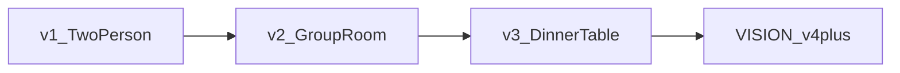

# Voice Bridge

[](https://github.com/hermantanya/voice-bridge/actions/workflows/check.yml)

Real-time voice translation between two devices. Hold a button, speak in your language, and your partner hears the translation in yours.

**v1.4 (current):** Everything in v1.3 plus **email sign-in**, **guest mode**, and **cloud profile sync** — Translate to, gender, and enrolled **cloned voice** follow your account across phone and web. Dev OTP codes on Railway until Resend is enabled for external beta.

**v1.3:** Auto-detect spoken language; **Translate to** UX; Settings voice preview.

**v1.2:** Cloned-voice TTS and Settings enrollment (~30s minimum).

**v1.1:** Preset OpenAI TTS (`nova`) — still used as fallback when a participant has not enrolled a voice.

## What it does

- Two people join the same room with a short code
- Each person sets **Translate to** (English, Hebrew, or Russian — the language you want to hear) and **My gender** (for correct Hebrew/Russian grammar in translations)
- **Speak any supported language** — the server auto-detects what you said (EN / HE / RU)
- **First come, first serve:** whoever holds **Hold to talk** first speaks
- Speech is transcribed, translated when needed, and played to the other person
- **Same language:** if you speak the language your partner wants to hear, they get the transcript only (no robotic TTS replay)
- **Real voice (v1.2+):** enroll once in Settings → partner hears translations in **your** cloned voice (ElevenLabs IVC); unenrolled users fall back to preset voice
- **Voice preview (v1.3):** replay a short sample of your enrolled voice from Settings without re-recording
- Transcripts appear in a scrollable two-column history (You / Others)
- Session stats track connection time and each person's speaking time (hold + translation)
- On web, choose which microphone to use (e.g. Mac built-in vs. phone relay)

## How to use it

### 1. Set languages (before joining)

On each device: tap the language badge on the home screen (or **Language settings**) and pick **Translate to** — the language **you want to hear** translations in. Set **My gender** there too — it improves Hebrew and Russian translations (verb forms, adjectives, second-person address).

You can speak English, Hebrew, or Russian in any turn; the server detects it automatically.

Example: Person A sets Translate to Hebrew, Person B sets Translate to English. Either can speak any of the three languages; each hears translations in their chosen language.

> Translate-to and gender are sent when you join a room. If you change them later, leave and rejoin.

**Web only:** open **Language settings** to pick your microphone if the browser chose the wrong device (common on Mac when an iPhone is nearby).

### 1b. Set up your voice (optional, v1.2+)

In **Language settings** → **Set up my voice**:

1. Read the on-screen script (~45–60 seconds; **30 seconds minimum** to create). Script language defaults to your Translate-to setting; change it on the setup screen if needed.
2. Stop recording, review, then **Create my voice**
3. Preview plays a short phrase in your cloned voice
4. Join a room — your partner hears translations in **your** voice

Already enrolled? Use **Play voice preview** in Settings to hear your voice again without re-recording.

When **signed in**, Translate to, gender, and your enrolled voice sync across devices. **Guests** keep settings and voice on this device only. Re-enroll or remove from Settings anytime.

### 2. Start a session

| Device | Action |
|---|---|
| **Phone** | Create a new room (note the code) |
| **Browser or second phone** | Enter the code → Join room |

Both should show **2 participants**.

### 3. Talk

1. When both see **Ready: hold to talk**, either person can press first
2. Hold the button, speak, then release
3. Wait a few seconds for translation
4. The other person hears the translated audio automatically
5. Floor opens again; next person to press speaks

### Testing with phone + Mac browser

```bash
# Terminal 1: phone (Expo Go)
cd apps/mobile
cp .env.example .env   # first time only; set your server URL in .env
npx expo start

# Terminal 2: browser
cd apps/mobile
npx expo start --web
```

Open `http://localhost:8081` in Chrome. Allow microphone when prompted. If the wrong mic is selected, open **Language settings** from the home screen and choose your Mac's built-in microphone.

### 4. Session screen

Once two participants are connected, the session shows:

| Stat | Meaning |
|---|---|
| **Session duration** | Wall-clock time since you both connected |
| **Your speaking time** | Your hold-to-talk + translation time (updates when your turn finishes) |
| **Partner speaking time** | Their hold + translation time (updates when their turn finishes) |

While you hold the button or translation is running, the button animates and speaking times stay frozen until that turn completes.

## Architecture

**v1.4 (current):** Same pipeline as v1.3; signed-in users load **hearLang**, **speakerGender**, and **elevenlabsVoiceId** from Postgres via JWT profile APIs before joining rooms.

**Provider history:** OpenAI Custom Voices was spiked and blocked (404). Fish Audio was spiked as an alternative; **ElevenLabs** was chosen for v1.2 production. See [EXECUTION_PLAN.md](EXECUTION_PLAN.md).

```
Phone/Browser                    Railway Server                 OpenAI + ElevenLabs
     │                                │                              │
     │  WebSocket (Socket.io)         │                              │
     ├───────────────────────────────►│  Whisper STT (auto-detect) ──►│ OpenAI
     │  join_room (hearLang + voice_id)│  GPT-4o-mini translate ─────►│ OpenAI
     │  audio_chunk / claim_turn      │  ElevenLabs TTS (speaker's   │
     │◄───────────────────────────────┤   cloned voice_id) ─────────►│ ElevenLabs
     │  translation_result + audio    │                              │
```

## Project structure

```
voice-bridge/
├── server/           # Node.js + Socket.io backend
├── apps/mobile/      # Expo app (iOS, Android, web)
├── package.json      # Railway deploy entry
└── railway.toml      # Railway build config
```

## Server setup

### Prerequisites

- Node.js 20+
- OpenAI API key with credits (Whisper + GPT translate)
- ElevenLabs API key on **Starter** tier or above (voice cloning + TTS)

### Local development

```bash
cd server
npm install
cp .env.example .env   # add OPENAI_API_KEY
npm run dev
curl http://localhost:3001/health
```

### Deploy to Railway

1. Push this repo to GitHub
2. Railway → **Deploy from GitHub** → select the repo
3. Root directory: **repository root** (uses `railway.toml`)
4. Variables:
   - `OPENAI_API_KEY`: your key (no trailing spaces)
   - `ELEVENLABS_API_KEY`: your key (Starter tier for voice cloning)
   - `CLIENT_ORIGIN`: `*` for dev, restrict in production
5. Verify: `https://<your-app>.up.railway.app/health`

### Point the app at your server

```bash
cd apps/mobile
cp .env.example .env
```

Edit `.env` (never commit this file):

```bash
EXPO_PUBLIC_SERVER_URL=https://your-app.up.railway.app
```

Restart Expo after changing (`npx expo start --clear`).

### Voice cloning (v1.2+ — shipped)

**Provider:** ElevenLabs IVC (Instant Voice Cloning). OpenAI handles Whisper STT (auto-detect in v1.3) and GPT-4o-mini translation only.

Enrollment flow: Settings → record script (30s minimum) → `POST /api/voices/enroll` → `voice_id` saved locally → sent on every `join_room`. The **listener** hears translation synthesized with the **speaker's** cloned voice.

**Replay enrolled voice:** Settings → **Play voice preview** → `POST /api/voices/preview` with stored `voice_id` → short TTS sample in your Translate-to language.

**Spike scripts** (reference / re-test quality):

```bash
cd server
cp .env.example .env   # OPENAI_API_KEY + ELEVENLABS_API_KEY

npm run spike:voice:elevenlabs
npm run spike:voice:elevenlabs -- --sample ./tmp/voice-sample.wav

# Fish Audio alternative (not used in production)
npm run spike:voice:fish
```

Historical OpenAI spike (reference only):

```bash
npm run spike:voice
```

## WebSocket events

| Event | Direction | Purpose |
|---|---|---|
| `join_room` | client → server | Join with room code, `hearLang` (Translate to), gender, optional `elevenlabsVoiceId` |
| `claim_turn` | client → server | Claim speaking turn (first press wins) |
| `audio_chunk` | client → server | Send recorded audio |
| `turn_state` | server → clients | Whose turn / processing state |
| `translation_result` | server → listener | Translated audio + transcript |
| `translation_sent` | server → speaker | Confirmation + transcript |
| `usage_update` | server → clients | Session timing sync (speaking times update on turn complete) |
| `error` | server → client | Error message |

**Usage metrics:** Session duration is wall-clock from when two participants join. The app shows **your speaking time** and **partner speaking time** (each person's hold + translation). The server also tracks a merged room total for billing (overlapping speech is not double-counted); that internal metric is not shown in the session UI.

`audio_chunk` may include `recordingStartedAt` (epoch ms) so the server can anchor each interval at hold-to-talk start.

## API

`POST /api/translate?sourceLang=auto&targetLang=he&format=wav`: send raw audio, get JSON with `sourceText`, `translatedText`, `audioBase64`, `latencyMs`. Default `sourceLang=auto` detects spoken language.

`POST /api/voices/enroll`: JSON body with `audioBase64`, `format`, `durationMs`, `language`, optional `gender` — creates ElevenLabs IVC clone, returns `{ voiceId, previewAudioBase64 }`.

`POST /api/voices/preview`: JSON body with `voiceId`, `language`, optional `gender` — synthesizes a short preview phrase for an existing enrolled voice.

`DELETE /api/voices/:voiceId`: remove enrolled voice from ElevenLabs.

`GET /health`: server status.

## Testing

Every push and pull request to `main` runs the **Ship gate** GitHub Actions job: `npm run check` at the repo root (Node 20, `npm ci` in `server/` and `apps/mobile/`).

| Command | What it runs |
|---|---|
| `npm run check` | Full ship gate: tests + verify + server typecheck |
| `npm test` | Server integration/unit tests, then mobile unit tests |
| `npm run verify` | Mobile layout/docs checks + **35** `verify-regressions` source suites (includes batch PTT `stopStreamingPtt` guard and speaker/listener TTS playback) |
| `npm run check:regression` | Same 35 regression suites only (`apps/mobile/scripts/verify-regressions.mjs`) |
| `npm run typecheck` | Server `tsc --noEmit` |

**Server tests** (explicit list in `server/package.json`) include `latency.integration.test.ts`, `streamingPtt.integration.test.ts`, and `join-room.integration.test.ts`.

**Mobile tests** include `transcriptState.test.ts` (PTT transcript dedupe / partner partial flush) plus session, hold-to-talk, and web mic coverage.

CI fails the job if any of the ship-gate files above are deleted, if tests fail, if regression grep checks fail (for example `void stopStreamingPtt` without awaiting when batch uplink is off), or if TypeScript does not compile.

Run locally before pushing:

```bash
npm run check
```

## Security

- API keys live only in `server/.env` (local) or Railway Variables (production)
- Never commit `.env` files
- Before pushing: `git grep -iE "sk-|api_key" -- ':!*.example'`

### Going public on GitHub

Treat your **server URL** like an API key: keep it in `apps/mobile/.env` (gitignored), not in source code. The repo ships `.env.example` with a placeholder.

The mobile app connects to your Railway deployment. If someone learns that URL, they could use your server and spend OpenAI and ElevenLabs credits. Rate limits (below) reduce that risk.

**Built-in rate limits** (per IP / per connection):

| Variable | Default | Protects |
|---|---|---|
| `RATE_LIMIT_TRANSLATE_PER_HOUR` | 30 | REST `/api/translate` |
| `RATE_LIMIT_ENROLL_PER_HOUR` | 10 | Voice enrollment (`/api/voices/enroll`) |
| `RATE_LIMIT_AUDIO_PER_HOUR` | 120 | WebSocket translations |
| `RATE_LIMIT_JOIN_PER_MINUTE` | 20 | Room join attempts |

Set these in Railway Variables. For personal use, defaults are plenty. Tighten if needed.

### Production operator checklist (Railway + Supabase)

Use this after deploy or when rotating secrets. Production URL example: `https://voice-bridge-production-c537.up.railway.app`.

| Check | Variable / action | Notes |
|---|---|---|
| Server up | `GET /health` | Expect `"status":"ok"` and `"version"` matching [package.json](package.json) |
| Database | `DATABASE_URL` | Supabase **Session pooler** URI (TLS); accounts live in Postgres |
| Auth signing | `AUTH_JWT_SECRET` | Long random string; changing it signs everyone out |
| OpenAI | `OPENAI_API_KEY` | STT + translation |
| ElevenLabs | `ELEVENLABS_API_KEY` | Voice enroll + cloned TTS |
| CORS / WebSocket | `CLIENT_ORIGIN` | `*` for dev; restrict to your web origin when you have a fixed domain |
| OTP email (external beta) | `RESEND_API_KEY`, `AUTH_FROM_EMAIL` | **Deferred** until you have a **domain** + external testers; Resend Free is enough |
| Dev OTP on screen | `AUTH_DEV_RETURN_OTP` | **`true`** for household testing **without a domain**; **`false`** when real email is live |
| Mobile app | `apps/mobile/.env` | `EXPO_PUBLIC_API_URL` → your Railway HTTPS URL (gitignored) |

**Smoke test (2 min):** `/health` → mobile sign-in (OTP) → change Translate to on device A → open Settings on device B and confirm sync within a few seconds → create/join a room with two participants.

**Optional later:** per-room tokens, or requiring everyone to self-host their own Railway backend.

## Known limitations (v1.4)

- Two participants per room only
- English, Hebrew, and Russian only (auto-detected; any pair: EN ↔ HE ↔ RU)
- One speaker at a time; floor is open until someone presses (not pre-assigned)
- ~3–6 second latency per message
- Web push-to-talk requires Chrome; mic active only while holding button
- Translate-to and gender settings apply on room join; rejoin after changes
- Speaking time counts update after each turn completes, not live during hold
- Real voice requires one-time enrollment; unenrolled users use preset TTS
- **Guests:** voice and language prefs stay on this device only; sign in to sync
- Signed-in Settings refresh on other devices polls every few seconds (not instant push)
- OTP email uses dev on-screen codes until Resend is configured for external beta
- Cloned voices live under the server's ElevenLabs account (Starter slot cap)
- Same-language turns deliver transcript only (no audio playback to listener)

## Roadmap

Near-term engineering steps: **[EXECUTION_PLAN.md](EXECUTION_PLAN.md)**.

### Shipped and next (v1.x)

| Version | Features |
|---|---|
| **v1.0** (done) | EN ↔ HE, 2 participants, push-to-talk, first-come-first-serve turns, phone + web |
| **v1.1** (done) | + Russian (EN ↔ HE ↔ RU); scrollable transcript; session + speaking time stats; web mic picker; merged room usage on server (for future billing) |
| **v1.2** (done) | Real voice on translated speech (ElevenLabs IVC); Settings enrollment (~30s minimum); gender-aware Hebrew/Russian translation; device-local `voice_id`; preset fallback |
| **v1.3** (done) | Auto-detect spoken language; **Translate to** UX; same-language transcript-only skip; Settings voice preview; join waits for voice profile load |
| **v1.4** (done) | Email OTP sign-in; guest mode; Postgres profiles; sync Translate to + gender + cloned voice; welcome/auth entry; Settings draft save |
| v1.5 | Internal dogfood + CI (dev OTP OK). **External beta later:** cheap domain + Resend Free + EAS link — see [EXECUTION_PLAN.md](EXECUTION_PLAN.md) **External beta readiness** |

### Group and table (v2–v3)

| Version | Features |
|---|---|
| **v2.0** (standalone) | **Push-to-talk** + **self-mute** (Live/Muted); iOS WAV upload reliability; server `utterance` path kept for integrations — **no in-app hands-free VAD** |
| **v2.x** (planned) | **Streaming PTT** — partial transcript/translation while you hold the button; finalize + TTS on release ([EXECUTION_PLAN.md](EXECUTION_PLAN.md#streaming-ptt-milestone-planned)). **Batch PTT regression tests are required for any streaming change** (`npm run check`). |
| v2.x call add-on | **Future:** Zoom / WhatsApp / video-call integration using server utterance routing (not the standalone app mic path) |
| v2.1 | 3–6 participants; device = persona (no shared-mic diarization yet) |
| v2.5 | Per-persona mute/unmute; per-speaker transcripts |
| v3.0 | Dinner table mode: multi-lingual room, mute matrix, mixed pass-through |
| v3.1 | Minute-based pricing + usage dashboard (uses server-side merged speaking intervals) |

### Product arc

v1 is a two-person walkie-talkie interpreter. v2 standalone focuses on **trustworthy PTT + self-mute**; hands-free for **calls/meetings** is a separate integration track (see EXECUTION_PLAN). v3 targets a dinner-table interpretation layer where each person hears what they need and can mute what they don't.



For mission statement and long-term direction (wearables, multimodal intent, v4+): see [VISION.md](VISION.md).

## License

Personal project in real-time voice translation. All rights reserved.
